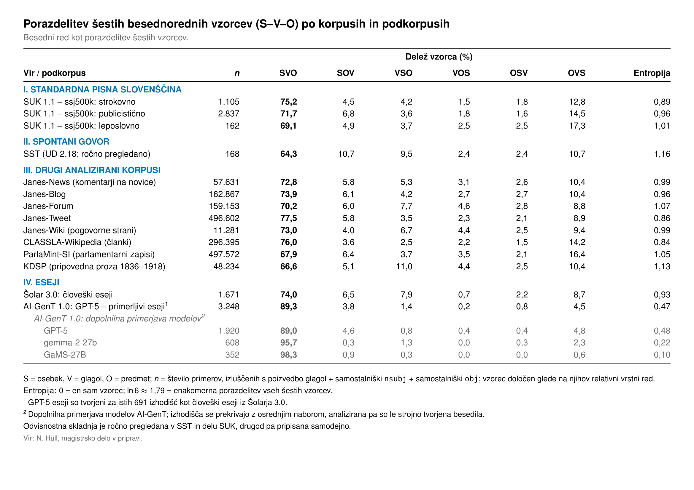
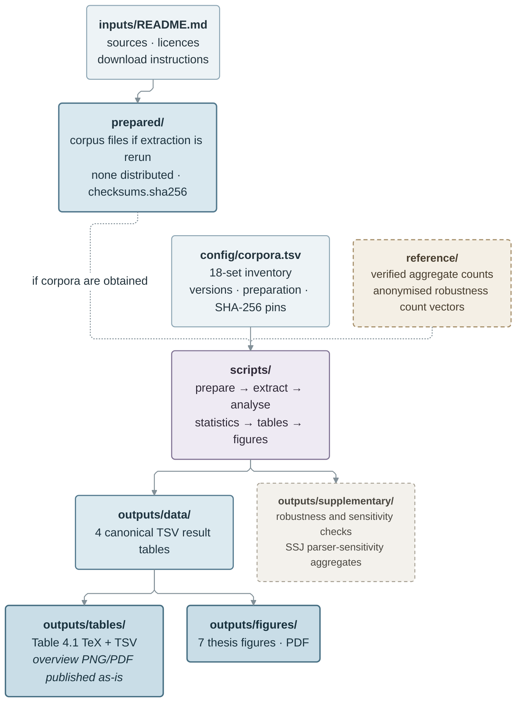
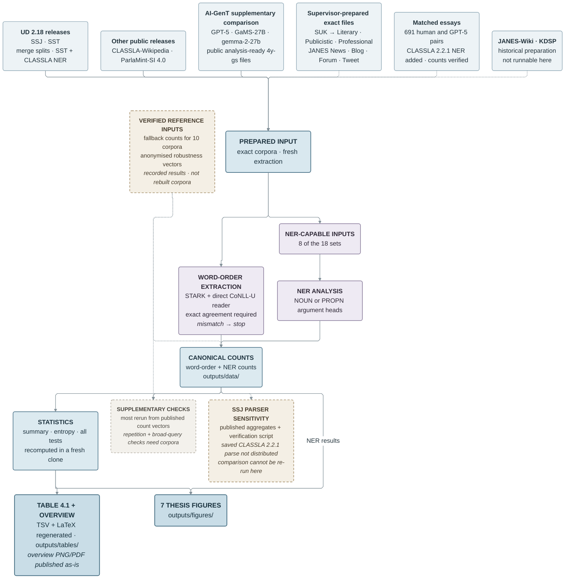

# Word order in Slovenian: reproducibility package

This repository accompanies the master's thesis *Besedni red v slovenskih
besedilih: Korpusna analiza žanrske in slogovne variacije z metodami NLP*
(N. Hüll, University of Ljubljana, 2026). The thesis examines how the six
possible orders of subject (S), verb (V) and object (O) are distributed in
Slovenian corpora of different genres, registers and media, and in human and
GPT-5 essays. It tests two hypotheses about genre (H1, H2), compares written,
spoken, web and parliamentary material descriptively, and adds robustness
checks and a case study of machine-generated essays.

The repository holds the counts, statistics, tables and figures reported in
the thesis, the scripts that produced them, and the information needed to
obtain the corpora. It supports the main reported results and selected
supplementary analyses; some thesis analyses remain outside the package (see
the limitations below). No complete corpus files are distributed here; the
only corpus text included is a set of ParlaMint-SI sentence extracts used in
one sensitivity check.

## Results at a glance

[](outputs/tables/word_order_overview_sl.pdf)

This one-page overview (in Slovenian) shows how the six S/V/O word-order
patterns are distributed, with sample sizes and entropy, in 17 of the 18
analysed datasets. The SSJ reference treebank is intentionally omitted from
the visual overview because its material largely overlaps with the SUK genre
subsets; the canonical data and thesis Table 4.1 include it. The percentages
are descriptive and reflect the analysed samples and the extraction query
described below. Click the preview for the full-resolution PDF
([`outputs/tables/word_order_overview_sl.pdf`](outputs/tables/word_order_overview_sl.pdf));
the canonical data behind the overview are in
[`outputs/tables/word_order_overview.tsv`](outputs/tables/word_order_overview.tsv).

## Contents

| Directory | Description |
|---|---|
| `outputs/data/` | Four canonical result tables: six-pattern counts for all 18 analysis sets, one-row summaries with entropy, splits by named-entity recognition (NER) status, and every statistical test. |
| `outputs/tables/` | Thesis Table 4.1 as LaTeX and as TSV. |
| `outputs/figures/` | The seven thesis figures (PDF). |
| `outputs/supplementary/` | Robustness and sensitivity checks: manually checked subset, document- and event-level permutation tests, paired essay test, bootstrap confidence intervals, Cramér's V, broad-argument query, exact-text repetition sensitivity, SSJ parser sensitivity. |
| `reference/` | Verified counts for corpora that cannot be rebuilt here, and anonymised per-document, per-event and per-pair count vectors used by the robustness checks. |
| `config/corpora.tsv` | Inventory of the 18 analysis sets: source, version, preparation step, sentence count and SHA-256 of each prepared file. |
| `scripts/` | Preparation, extraction, statistics, table and figure scripts. |
| `inputs/`, `prepared/` | Where corpus files go if the extraction is rerun. Their READMEs describe sources, licences and preparation. |

The directories relate as follows; dotted arrows mark corpus material that
is not distributed here and the stored reference inputs:



## Main results

| Thesis item | File |
|---|---|
| Table 4.1, all 18 sources | `outputs/tables/word_order_overview.tex` and `.tsv`; the numbers come from `outputs/data/word_order_summary.tsv` |
| Table 4.2, SVO share and entropy with 95 % intervals | `outputs/supplementary/h2_cluster_bootstrap.tsv` |
| Table 4.3, pairwise permutation tests and Cramér's V | `outputs/data/statistical_tests.tsv` (families `h2_prespecified` and `selected_validation`) and `outputs/supplementary/cramers_v_selected.tsv` |
| H1 omnibus test | `outputs/data/statistical_tests.tsv`, family `h1_omnibus` |
| Table 4.4, manually checked subset | `outputs/supplementary/manual_subset_h2.tsv` |
| Table 4.6 and the named-entity tests | `outputs/data/ner_word_order.tsv`; families `ner_fisher_*` in `statistical_tests.tsv` |
| Document-, event- and pair-level checks | `outputs/supplementary/h1_document_cluster.tsv`, `h2_cluster_robustness.tsv`, `paired_essay_robustness.tsv` |
| Table B.2, repetition sensitivity | `outputs/supplementary/dedup_sensitivity.tsv` and `repetition_sensitivity.md` |
| Section 4.2.4, parser sensitivity on SSJ | `outputs/supplementary/parser_sensitivity.md` and the `parser_sensitivity_*` tables |
| Figures 3.1 and 4.1 to 4.6 | `outputs/figures/`: `fig_research_workflow`, `fig_h1_h2_patterns`, `fig_register_patterns`, `fig_human_gpt5_patterns`, `fig_jsd_matrix`, `fig_ner_objects`, `fig_svo_entropy` |

Jensen–Shannon distances and cosine similarities for all pairs of sources are
in `statistical_tests.tsv` (family `all_pairwise`). That family also contains
additional pairwise comparisons outside the thesis hypotheses; the
prespecified tests are `h1_omnibus` and `h2_prespecified`.

## Data flow



Solid arrows run from obtainable inputs. Dotted arrows mark what cannot be
rebuilt from public material alone: exact prepared files that are not
distributed here, the stored reference inputs, and the verification-only
parser-sensitivity route. The exact route for each corpus is in the
availability table below.

## Reproduction of the calculations

The main statistical calculations are recomputed from the count tables
included in the repository. The repetition-sensitivity check needs corpus
files (see below), and the broader-argument query needs the prepared UD 2.18
SSJ and SST corpora. The parser-sensitivity check verifies the published
aggregates; its historical comparison cannot be rerun from the public files
(see `outputs/supplementary/parser_sensitivity.md`). The count-based calculations
need Python 3.10–3.12 and the four packages in `requirements.txt`; they need
neither corpus files nor STARK.

```bash
git clone https://github.com/hulln/sl-word-order-repro.git
cd sl-word-order-repro
python3 -m venv .venv && source .venv/bin/activate
pip install -r requirements.txt
python3 scripts/compute_statistics.py              # summary and all statistical tests
python3 scripts/supplementary_manual_subset.py
python3 scripts/supplementary_robustness.py
python3 scripts/supplementary_h2_cluster_bootstrap.py
python3 scripts/supplementary_cramers_v.py
python3 scripts/test_parser_sensitivity.py         # verifies the parser-sensitivity aggregates
python3 scripts/make_master_table.py               # Table 4.1
python3 scripts/make_figures.py                    # the seven figures
```

Each script writes its output files in place. The scripts check their inputs
and compare key results with the values recorded for the thesis, stopping
with an error if a recorded value differs, so a run that completes has
reproduced the stored outputs. The figures are regenerated with the same
content and page size as the thesis figures; only the PDF metadata differs.

### The word-order query

All analyses use one dependency query, run with STARK and checked with an
independent direct reader of the CoNLL-U files:

```text
upos=VERB >nsubj upos=NOUN >obj upos=NOUN
```

It selects a verb with a nominal subject (`nsubj`) and a nominal object
(`obj`), both headed by a common noun. Every subject × object pair of the same
verb is one instance, classified as SVO, SOV, VSO, VOS, OSV or OVS by the
order of the three tokens. Clauses without an expressed subject, pronominal
arguments and indirect objects (`iobj`) are outside the query. STARK runs with
`label_subtypes=no`, so relation subtypes are collapsed, whereas the direct
reader requires exact `nsubj` and `obj`; no such subtypes occur in the analysed
Slovenian sources, so the two agree exactly. The named-entity analysis uses
the same relations but allows `NOUN` or `PROPN` argument heads.

### Extraction from the corpus files

The counts themselves can be re-extracted only with the corpus files. Obtain
them as described in `inputs/README.md`, install
[STARK](https://github.com/clarinsi/STARK) (the thesis used commit `fd0202d`,
`v3.1.0-3-gfd0202d`) and its requirements in the same environment, then run

```bash
python3 scripts/run_all.py --stark /path/to/STARK/stark.py --use-reference-cache
```

`--use-reference-cache` substitutes the verified stored counts for the ten
corpora listed in `reference/README.md`; SSJ, SST, the three SUK genre files
and the three AI-GenT files must then exist under `prepared/`. Without the
option all 18 prepared files are required. Only the preparation steps that add
CLASSLA named-entity tags need `requirements-annotation.txt`. The exact-text
repetition check (`scripts/dedup_sensitivity.py` and
`scripts/inspect_parlamint_duplicates.py`) also needs the four large prepared
corpora; see `outputs/supplementary/repetition_sensitivity.md`.

## Data availability and limitations

The 18 analysis sets do not all enter the workflow in the same way:

| Corpus | Available route |
|---|---|
| SSJ; SST | Rebuild from the public UD 2.18 releases. SST also needs the annotation dependencies. |
| SUK literary / publicistic / professional | Reanalyse from the exact supervisor-prepared composite or derived files. The public SUK CoNLL-U is not the same corpus. |
| JANES News / Blog / Forum / Tweet | Reanalyse if the exact supervisor-prepared files are available; otherwise use verified stored counts. |
| JANES-Wiki; KDSP | The historical preparation is not runnable here; use verified stored counts unless the exact prepared files are available. |
| CLASSLA-Wikipedia; ParlaMint-SI | Rebuild from the public releases, or use verified stored counts. |
| Human essays | Reanalyse from the prepared matched subset if available; otherwise use verified stored counts. |
| GPT-5 essays | Normalise the AI-GenT essay cell to the pinned base file, then add NER; preparation performs only the NER step. Otherwise use verified stored counts. |
| AI-GenT supplementary GPT-5 / GaMS-27B / gemma-2-27b | Copy the public analysis-ready `4y-gs`, default-prompt files. |

Sources, exact paths, licences and caveats are in
[`inputs/README.md`](inputs/README.md).

Limitations of the package:

- The full extraction cannot be completed from public sources alone: the exact
  SUK composite, four JANES conversions, JANES-Wiki preparation, KDSP preparation
  and human essay file are not distributed here.
- The SUK composite is wider than the public CoNLL-U release. Where comparison
  was possible, its query-relevant fields matched SUK 1.1.
- ParlaMint-SI is rebuilt by concatenating the distributed CoNLL-U files in
  lexicographically sorted full-path order.
- The 691 human and GPT-5 essays are matched by document. GPT-5 syntax comes from
  AI-GenT; the human syntactic annotator remains undocumented in the available
  provenance evidence.
- The supplementary AI-GenT `4y-gs` comparison uses different generated texts
  and prompts. Its 205 GPT-5 source documents overlap the matched 691, so it is
  not an independent replication.
- Automatically labelled NER results are exploratory and classify only the
  argument head token.
- Some thesis analyses are not reproducible from this package: the ACT/PAT
  semantic-role comparison (Table 4.5), the corpus-overlap audit, the
  passive-construction measurement on ssj500k-syn, the manual validation of 30
  extracted hits, and the parser evaluation in Appendix C. They depend on
  restricted inputs (the SUK TEI files) or were produced in other repositories;
  the parser evaluation is published separately at
  <https://github.com/hulln/conllu-tag-based-eval>. The thesis reports their
  results, but the numbers cannot be regenerated from the files here.
- The parser-sensitivity check on SSJ (Section 4.2.4) is published as verified
  aggregate tables with a verification script (see
  `outputs/supplementary/parser_sensitivity.md`). The reference side can be
  rebuilt from the public UD 2.18 release; the automatic side is the saved
  CLASSLA-Stanza 2.2.1 parse of the same sentences, which is not distributed
  and cannot be regenerated bit-identically, so the published aggregates can
  be verified and cross-checked but the comparison itself cannot be
  independently re-run from public files.

## Licence and citation

Code and repository content: **GNU GPL version 3 or later**
([`LICENSE`](LICENSE); SPDX: `GPL-3.0-or-later`).

The GPL covers this repository only and grants no rights over any corpus. No
complete corpus files are distributed here; each corpus keeps the licence of
its original release, listed in [`inputs/README.md`](inputs/README.md), and
several are non-commercial or share-alike. The ParlaMint-SI sentence extracts
in `outputs/supplementary/` keep that corpus's CC BY 4.0 licence (see the
README there). To cite the package, see [`CITATION.cff`](CITATION.cff).
